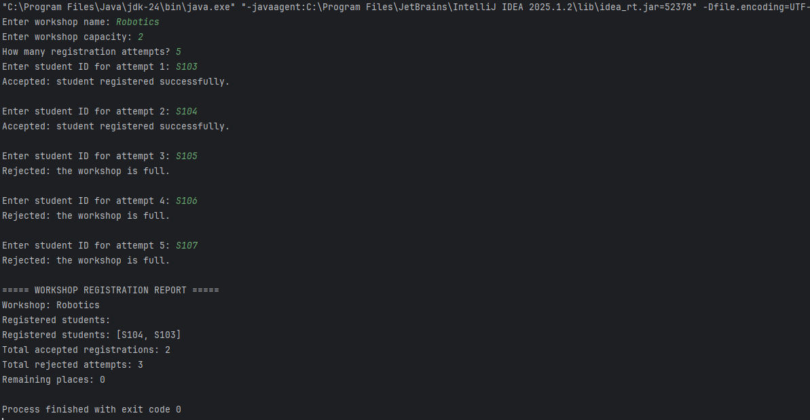
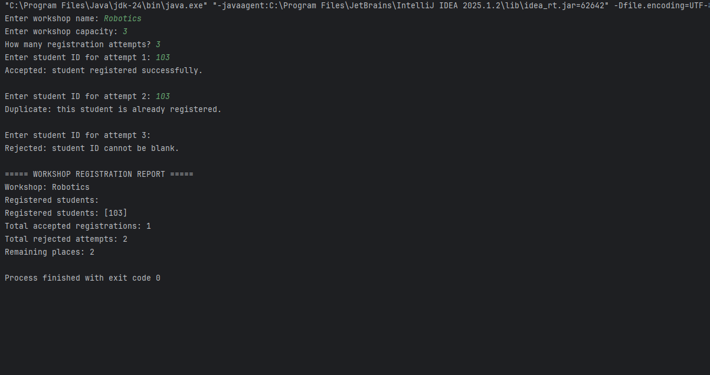

# OOP Coding Test — Review and Reflection

## 1. My Original Examination Grade

### Task 1 — Workshop Class (8/40)

**My self-assessed mark: 8/40**

**Why I awarded this mark:**

I awarded myself 8 marks because I managed to create the Workshop class and correctly declare some of the private fields, including `workshopName` and `capacity`. I also attempted to create a constructor and getter methods.

However, I made several mistakes. I used a boolean for `studentID` instead of the required `HashSet<String>`. I did not correctly assign the constructor parameters to the fields using `this`. Some of my getter methods also had incorrect return types. In `Main.java`, I attempted to use Scanner to get user input, but I did not successfully read both the workshop name and capacity or create the Workshop object.

I believe 8 marks is fair because I demonstrated some understanding of classes, fields, constructors and user input, but I did not successfully complete most of the requirements.

### Task 2 — Process Registrations (5/40)

**My self-assessed mark: 5/40**

**Why I awarded this mark:**

I awarded myself 5 marks because I attempted to use Scanner to collect user input and created a while loop to process registration attempts. I also attempted to use `Integer.parseInt()` to convert the number of registration attempts and used try-catch to handle invalid input.

Unfortunately, I did not successfully implement the main registration functionality. I did not create or use a HashSet to store student IDs, prevent duplicate registrations or check whether the workshop was full. I also did not correctly connect my Main class to the Workshop class.

I believe 5 marks is fair because I demonstrated some understanding of user input, loops and exception handling, but I was unable to complete the required registration process.

### Task 3 — Registration Report and Validation (2/20)

**My self-assessed mark: 2/20**

**Why I awarded this mark:**

I awarded myself 2 marks because I attempted to create a separate RegistrationTracker class and use a collection to help manage registrations.

However, I did not successfully implement the registration report. My code did not display all successfully registered student IDs, calculate the total accepted registrations or rejected attempts, or show the number of places remaining. I also did not correctly validate blank student IDs or make sure they were counted as rejected attempts without changing the collection.

I believe 2 marks is fair because I made an attempt to organise the registration-tracking functionality, but the required features were not working correctly.

**Total self-assessed examination mark: 15/100**

---

## 2. Corrections and Improvements

After reviewing my original code, I identified three important problems that I needed to improve.

**1. Incorrect use of HashSet**

One important problem I identified in my original code was that I did not understand how to use a HashSet to store student IDs and prevent duplicate registrations. In my original code, I used a boolean for the student ID instead of a collection.

In my review version, I am correcting this by using a `HashSet<String>` in my Workshop class. A HashSet stores unique values, which means it prevents the same student ID from being registered more than once.

**2. Problems connecting my classes**

Another problem was that my Workshop class and Main class were not properly connected. I had difficulty creating and using objects and passing information between classes.

I am improving this by creating a Workshop object in Main and using methods from the Workshop class to manage registrations. This makes the code more organised and allows each class to have a clearer purpose.

**3. User input and validation**

A third problem was that I did not correctly handle user input or validate student IDs.

I am improving this by using Scanner to collect input, checking for blank student IDs and making sure rejected registrations are not added to the HashSet. I am also making sure that the program checks for duplicate IDs and available places before accepting a registration.

---

## 3. Testing and Demonstration

I tested my corrected program using different registration scenarios to make sure the requirements worked correctly.

### Test 1 - Full Workshop

### Test 2 - Duplicate and Blank Student ID

I tested my corrected program using different registration scenarios to make sure that the requirements worked correctly.

The tests included:

| Test | What I checked | Result |
|---|---|---|
| Successful registration | Entered a new student ID when places were available | Passed |
| Duplicate registration | Entered the same student ID twice | Passed |
| Workshop full | Tried to register another student when the workshop was full | Passed |
| Blank student ID | Entered a blank student ID | Passed |
| Final report | Checked the registered IDs, accepted registrations, rejected attempts and remaining places | Passed |

I also checked that rejected registrations did not change the HashSet and that duplicate IDs were still identified as duplicates even when the workshop was full.

The screenshots above show examples of my program running and demonstrate the registration tests.

---

## 4. Reflection

### What did you understand during the examination but struggle to implement?

During the examination, I understood some of the basic ideas of Java, such as creating classes, using variables and writing loops. However, I struggled to put everything together into a working program. I also did not fully understand what a HashSet was or how I was supposed to use it for the registration system.

At the beginning of the exam, I also had a problem with the IntelliJ setup. When I opened the project on the PC, it seemed to be using the wrong version or configuration, and I could not even create String variables properly. I spent around 30 minutes trying to fix this before asking for help. This left me with much less time to complete the exam.

I also struggled with using Scanner to collect input from the user, as I was unsure how to apply it in the program.

### What was the most important thing you learned from correcting your code?

The most important thing I learned was how a HashSet works and how it can be used to store unique student IDs. I also learned that it is important to divide a program into separate classes and methods instead of trying to put everything into Main.

Correcting my code helped me understand how the different parts of an object-oriented program work together and how collections can be used to solve problems.

### What would you do differently in your next coding test?

In my next coding test, I would make sure that IntelliJ and the Java project are set up correctly before starting the exam. I would also read through the questions carefully and break the tasks into smaller steps instead of trying to write everything at once.

I would spend more time practising collections such as HashSet and using Scanner for user input so that I feel more confident when using them. I would also try to test my code as I go along rather than waiting until the end.

Overall, I would prepare more thoroughly, ask for help with unfamiliar concepts before the exam and try to manage my time better.

---

## 5. Review Lab Assessment and Mark Recovery

The review lab is graded separately out of 20 marks:

| Review criterion | Maximum marks |
|---|---:|
| Original self-assessment and supporting evidence | 4 |
| Explanation of mistakes and Java concepts | 6 |
| Corrections and improvements | 4 |
| Testing and demonstration | 4 |
| Reflection | 2 |
| **TOTAL** | **20** |

You can recover up to 30% of the marks you lost in the original examination. The actual amount depends on your review lab grade. Your lecturer's examination grade, not your self-awarded mark, is used in the calculation.

**Marks recovered = (100 − original exam mark) × 0.30 × (review lab mark ÷ 20)**

**Revised exam mark = original exam mark + marks recovered**

For example, an original examination mark of 40/100 and a review lab mark of 16/20 would recover 14.4 marks, giving a revised result of **54.4/100**.

The aim is to show that I understand my mistakes and can explain my improvements. Simply copying a working solution does not demonstrate this understanding.

